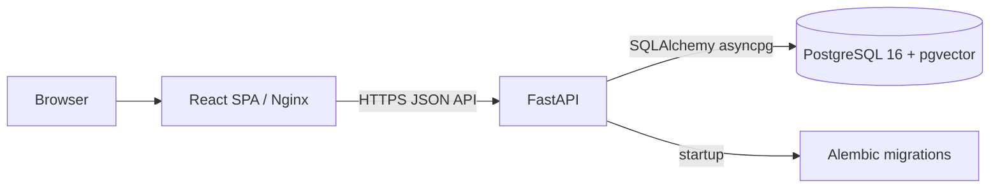
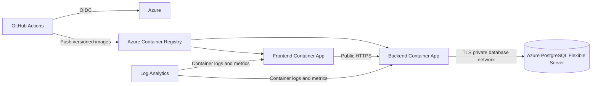

# Deploying EventSphere to Microsoft Azure

This guide deploys the existing EventSphere Docker application to Azure.
It uses Azure Container Apps for the React and FastAPI containers and Azure
Database for PostgreSQL Flexible Server for the persistent pgvector database.

The guide is written for PowerShell on Windows and is based on the current
repository. It does not modify application code or existing Docker
configuration.

## Official Microsoft references

Verify these official pages before executing commands because Azure names,
regions, availability, and prices can change:

- [Azure account and subscriptions](https://learn.microsoft.com/azure/cloud-adoption-framework/ready/azure-best-practices/initial-subscriptions)
- [Azure CLI install](https://learn.microsoft.com/cli/azure/install-azure-cli-windows)
- [Azure Container Registry](https://learn.microsoft.com/azure/container-registry/container-registry-intro)
- [Azure Container Apps overview](https://learn.microsoft.com/azure/container-apps/overview)
- [Container Apps environment variables and secrets](https://learn.microsoft.com/azure/container-apps/environment-variables)
- [Container Apps ingress](https://learn.microsoft.com/azure/container-apps/ingress-overview)
- [Container Apps revisions](https://learn.microsoft.com/azure/container-apps/revisions)
- [Azure Database for PostgreSQL Flexible Server](https://learn.microsoft.com/azure/postgresql/flexible-server/overview)
- [PostgreSQL networking](https://learn.microsoft.com/azure/postgresql/flexible-server/concepts-networking)
- [pgvector in Azure PostgreSQL](https://learn.microsoft.com/azure/postgresql/flexible-server/how-to-use-pgvector)
- [Container Apps managed identities](https://learn.microsoft.com/azure/container-apps/managed-identity)
- [GitHub OIDC with Azure](https://learn.microsoft.com/azure/developer/github/connect-from-azure)
- [Azure Cost Management](https://learn.microsoft.com/azure/cost-management-billing/costs/quick-acm-create-budgets)
- [Container Apps custom domains and TLS](https://learn.microsoft.com/azure/container-apps/custom-domains-managed-certificates)

---

## 1. What is being deployed

### Repository architecture



The repository contains:

| Component | Repository location | Container port |
|---|---|---|
| React/Vite frontend | `frontend/` | 80 |
| FastAPI backend | `backend/app/main.py` | 8000 |
| PostgreSQL 16 image | `pgvector/pgvector:pg16` | 5432 internally |
| Alembic migrations | `backend/alembic/versions/` | Runs before Uvicorn |
| Docker Compose | `docker-compose.yml` | Frontend 80, API 8000 |

FastAPI runs with:

```text
alembic upgrade head
uvicorn app.main:app --host 0.0.0.0 --port 8000
```

The backend health endpoints are:

- `GET /health`
- `GET /health/db`
- API routes are below `/api`

The frontend Docker build uses `VITE_API_URL` as a build argument. This value
is compiled into JavaScript and cannot be changed only by changing a running
container environment variable. Rebuild and push the frontend after changing
its production API URL.

The frontend is served by Nginx and uses SPA fallback routing.

### Recommended Azure architecture



- **Azure Container Registry (ACR):** stores private frontend and backend images.
- **Azure Container Apps:** runs the containers, provides HTTPS ingress, scaling,
  revisions, health checks, secrets, and managed identity.
- **PostgreSQL Flexible Server:** provides PostgreSQL 16, backups, patching,
  and the pgvector extension.
- **Log Analytics:** centralizes Container Apps logs and metrics.
- **GitHub Actions:** builds and deploys immutable commit-SHA-tagged images.

---

## 2. Before Azure: verify the local application

> **Destructive warning:** `docker compose down -v` deletes local database data.
> Do not run it unless you intentionally want to erase the local database.

Create a local `.env` from the committed example:

```powershell
Copy-Item .env.example .env
notepad .env
```

Set at least these values:

```dotenv
POSTGRES_USER=eventsphere
POSTGRES_PASSWORD=<a-unique-local-password>
POSTGRES_DB=eventsphere
JWT_SECRET_KEY=<at-least-32-random-characters>
CORS_ORIGINS=http://localhost
VITE_API_URL=http://localhost:8000/api
```

JWT secret values are not exposed by logs or health endpoints, but they must
remain private. Do not use the committed demo credentials or placeholders in
production.

Start the local stack:

```powershell
docker compose up --build -d
docker compose ps
docker compose logs --tail=100 backend
```

Verify HTTP responses:

```powershell
Invoke-RestMethod http://localhost:8000/health
Invoke-RestMethod http://localhost:8000/health/db
Invoke-WebRequest http://localhost/ -UseBasicParsing
```

For local backend-only development, configure
`backend/.env` with a local database URL. Do not copy a Docker-only hostname
such as `db` into the backend running on the Windows host.

Optional demo data:

```powershell
docker compose exec backend python scripts/seed_demo.py
```

Demo accounts are documented in `README.md`. Never use those passwords publicly.

---

## 3. Azure account and subscription prerequisites

Organizational account:

```text
samkit@iserve.onmicrosoft.com
```

> **Important:** The account name in this guide must match the real Entra ID
> tenant account. Having an organizational Microsoft account does not guarantee
> an Azure subscription or permission to create resources.

Install Azure CLI:

```powershell
winget install --exact Microsoft.AzureCLI
az version
```

Alternatively, follow Microsoft's official Windows installation page. Restart
PowerShell after installation if `az` is not found.

Sign in interactively:

```powershell
az login
```

If the organization requires a specific tenant:

```powershell
az login --tenant "<TENANT_ID>"
```

The tenant ID is available from Microsoft Entra admin center. Do not invent or
retype it; copy it from the tenant overview.

List subscriptions:

```powershell
az account list --output table
az account show --output json
```

Select a subscription:

```powershell
az account set --subscription "<SUBSCRIPTION_ID>"
az account show --query "{subscriptionId:id,tenantId:tenantId,name:name,state:state}" --output table
```

Check a role assignment:

```powershell
az role assignment list --assignee samkit@iserve.onmicrosoft.com --output table
az provider show --namespace Microsoft.App --query registrationState --output tsv
az provider show --namespace Microsoft.DBforPostgreSQL --query registrationState --output tsv
az provider show --namespace Microsoft.ContainerRegistry --query registrationState --output tsv
```

Register providers only if your permissions allow it:

```powershell
az provider register --namespace Microsoft.App
az provider register --namespace Microsoft.DBforPostgreSQL
az provider register --namespace Microsoft.ContainerRegistry
az provider register --namespace Microsoft.OperationalInsights
```

If no subscription is listed:

1. Contact the organization's Azure administrator.
2. Request a subscription or access to an existing development subscription.
3. Ask for:
   - **Contributor** for creating and managing assigned resources.
   - **Reader** only for viewing resources.
   - **Owner** only for full management plus role assignment and, only where
     explicitly approved, access to assign roles.
4. Confirm that your Azure CLI account and GitHub organization account are
   separate identities. Azure OIDC still requires a matching Entra tenant and
   federated credential configuration.

Do not attempt to create a personal subscription under a corporate account
unless organizational policy permits it.

---

## 4. Windows and repository prerequisites

Install and verify:

```powershell
git --version
docker version
docker compose version
az version
node --version
npm --version
```

Recommended versions:

- Git
- Docker Desktop or Rancher Desktop with Docker Compose v2
- Azure CLI
- VS Code
- Node 22 or the repository frontend Docker's Node 22 image
- Python 3.12 or the repository backend Docker's Python 3.12 image

For local development, Docker Desktop must be running. Azure deployment does
not require Docker Desktop after images are pushed, but it is useful for
testing before push.

---

## 5. Billable-resource planning

Creating an Azure Container Registry, Container Apps environment, PostgreSQL
Flexible Server, Log Analytics workspace, and public IP/network
resources can incur charges.

Before execution:

1. Have a subscription and confirmed Contributor or Owner access.
2. Check the Azure region is available for Container Apps, Flexible Server,
   PostgreSQL 16, and pgvector.
3. Set an Azure Cost Management budget.
4. Do not create Azure resources until the cost implications are understood.

The PostgreSQL Flexible Server is the most likely to be continuously billable.
Container Apps consumption workloads can scale down to zero when idle, but
PostgreSQL Flexible Server must be evaluated against your planned workload and
backup retention.

---

## 6. Choose deployment names

Use PowerShell variables only for the current session. Replace placeholders.

```powershell
$REGION = "<AZURE_REGION>"                 # Example: eastus
$RG = "rg-eventsphere-prod"
$ACR = "<UNIQUE_ACR_NAME>"                 # Lowercase letters and digits only
$ACA_ENV = "cae-eventsphere-prod"
$BACKEND_APP = "ca-eventsphere-api"
$FRONTEND_APP = "ca-eventsphere-web"
$PG_SERVER = "<UNIQUE_POSTGRES_SERVER_NAME>"
$PG_DB = "eventsphere"
$PG_ADMIN = "<POSTGRES_ADMIN_USER>"        # Not postgres or a reused local user
$PG_PASSWORD = "<GENERATED_PRODUCTION_PASSWORD>"
$JWT_SECRET = "<GENERATED_SECRET_AT_LEAST_32_CHARS>"
$LAW = "law-eventsphere-prod"
$SUBSCRIPTION_ID = "<SUBSCRIPTION_ID>"
$TENANT_ID = "<TENANT_ID>"
```

Never place real passwords in a shell history or committed file. Generate
them with a password manager or approved secret generator.

Example name checks:

```powershell
az acr check-name --name $ACR
az postgres flexible-server list-skus --location $REGION --output table
```

---

## 7. Create the resource group

A resource group is a lifecycle and access boundary, not a region constraint
for every contained resource.

Confirm the subscription first:

```powershell
az account show --query "{name:name,subscriptionId:id,state:state}" --output table
```

Create the group:

```powershell
az group create `
  --name $RG `
  --location $REGION
```

Choose a region close to the primary users while also confirming required
services and ACR/Container Apps availability.

---

## 8. Create Azure Container Registry

ACR is a private Docker image registry. It should remain private in production.

Create a low-cost Basic registry for development or staging:

```powershell
az acr create `
  --resource-group $RG `
  --name $ACR `
  --sku Basic `
  --admin-enabled false
```

ACR Basic, Standard, and Premium vary by features and cost. Basic is generally
only appropriate for low-volume development. Verify current pricing.

Authenticate Docker:

```powershell
az acr login --name $ACR
```

Build and push the repository images:

```powershell
$ACR_LOGIN_SERVER = az acr show --name $ACR --query loginServer --output tsv
$IMAGE_TAG = (git rev-parse --short HEAD)

docker build `
  --file backend/Dockerfile `
  --tag "$ACR_LOGIN_SERVER/eventsphere-backend:$IMAGE_TAG" `
  backend

docker build `
  --file frontend/Dockerfile `
  --build-arg "VITE_API_URL=https://<FRONTEND_TO_BE_CONFIGURED>/api" `
  --tag "$ACR_LOGIN_SERVER/eventsphere-frontend:$IMAGE_TAG" `
  frontend

docker push "$ACR_LOGIN_SERVER/eventsphere-backend:$IMAGE_TAG"
docker push "$ACR_LOGIN_SERVER/eventsphere-frontend:$IMAGE_TAG"
```

The frontend API URL placeholder must use the browser-visible backend URL,
not `http://backend:8000`. `/api` is included because the backend mounts every
router under `/api` and frontend API calls use that base.

You may also tag `latest`, but commit SHA tags provide a clear rollback target:

```powershell
docker tag "$ACR_LOGIN_SERVER/eventsphere-backend:$IMAGE_TAG" "$ACR_LOGIN_SERVER/eventsphere-backend:latest"
docker push "$ACR_LOGIN_SERVER/eventsphere-backend:latest"
```

List images:

```powershell
az acr repository list --name $ACR --output table
az acr repository show-tags --name $ACR --repository eventsphere-backend --output table
```

Prefer managed identity pull access instead of storing ACR administrator
credentials.

---

## 9. Create Azure PostgreSQL Flexible Server

Azure Database for PostgreSQL Flexible Server is recommended instead of a
container database in production because it provides managed patching,
automated backups, monitoring, point-in-time recovery, and HA options.

### Choose networking

Recommended: private access for the database. Container Apps must reach the
server over integrated virtual networking or an approved private networking
topology. Azure PostgreSQL private networking details must be verified for the
selected region and subscription.

If private networking is not available during initial setup, use a temporary
controlled public endpoint with firewall restrictions, then migrate to private
access before production. Public access should not be left open to `0.0.0.0`.

Create the server with an explicit PostgreSQL version:

```powershell
az postgres flexible-server create `
  --resource-group $RG `
  --name $PG_SERVER `
  --location $REGION `
  --admin-user $PG_ADMIN `
  --admin-password $PG_PASSWORD `
  --version 16 `
  --sku-name Standard_B1ms `
  --tier Burstable `
  --storage-size 32 `
  --database-name $PG_DB `
  --public-access 0.0.0.0
```

> **Security warning:** `--public-access 0.0.0.0` is a temporary placeholder
> for Azure to permit explicit firewall rules. It must not mean “allow every
> source IP.” Prefer private networking in production. Review Azure's
> flexible-server CLI help and private network configuration before using
> this command.

Server creation is billable. Review:

- PostgreSQL version: 16
- Compute size: use a small development SKU only for testing
- Storage: 32 GB as an initial minimum to verify, then size for growth
- Backups: confirm retention and redundancy
- High availability: enable only for production requirements

Azure Flexible Server supports PostgreSQL 16. Production SKU selection is not
determined by this repository and must be based on traffic and memory.

List approved SKUs:

```powershell
az postgres flexible-server list-skus --location $REGION --output table
```

### Configure TLS

Azure PostgreSQL should use encrypted TLS connections. Production
`DATABASE_URL` must include:

```text
sslmode=require
```

For asyncpg, the repository configuration can accept a URL containing query
parameters when Azure supports them. Verify the exact connection string in:

```powershell
az postgres flexible-server show-connection-string `
  --server-name $PG_SERVER `
  --database-name $PG_DB `
  --admin-user $PG_ADMIN
```

The database URL format is:

```text
postgresql+asyncpg://<PG_ADMIN>:<URL_ENCODED_PASSWORD>@<PG_HOST>:5432/<PG_DB>?sslmode=require
```

URL-encode all special characters in `<PG_ADMIN>` and
`<URL_ENCODED_PASSWORD>`. Never store this full URL in source control.

### Enable pgvector

In Azure PostgreSQL Flexible Server, pgvector availability depends on server
allow-list/configuration support in the selected region. Check the official
pgvector page linked above.

Enable the extension by server parameter or Azure allow-list workflow, then
create it once:

```sql
CREATE EXTENSION IF NOT EXISTS vector;
CREATE EXTENSION IF NOT EXISTS pg_trgm;
```

The migrations do this automatically:

- `0001_initial.py` creates `vector`
- `0005_performance_indexes.py` creates `pg_trgm`
- `0005_performance_indexes.py` creates an HNSW index on 384-dimension
  event embeddings
- `0007_search_history.py` creates the search-history table and vector column

The Azure database login used by the application must have permission to
create extensions and tables, or migrations must be run by an approved
administrative migration identity.

---

## 10. Create Log Analytics and Container Apps environment

Create the workspace:

```powershell
az monitor log-analytics workspace create `
  --resource-group $RG `
  --workspace-name $LAW `
  --location $REGION
```

Create the managed Container Apps environment:

```powershell
$LAW_ID = az monitor log-analytics workspace show `
  --resource-group $RG `
  --workspace-name $LAW `
  --query customerId `
  --output tsv

$LAW_KEY = az monitor log-analytics workspace get-shared-keys `
  --resource-group $RG `
  --workspace-name $LAW `
  --query primarySharedKey `
  --output tsv

az containerapp env create `
  --name $ACA_ENV `
  --resource-group $RG `
  --location $REGION `
  --logs-workspace-id $LAW_ID `
  --logs-workspace-key $LAW_KEY
```

The environment provides shared Container Apps networking and logging but does
not contain the database or application source code.

Container Apps supports public external ingress or internal-only ingress.
Use external ingress for the frontend. Public API ingress may be external if
the frontend calls it directly. Use internal-only ingress only when a
private reverse proxy or another approved routing layer reaches the backend.

---

## 11. Store demo secrets in Container Apps

This demo does not use Azure Key Vault. Container Apps stores the database
connection and JWT signing key as Container App secrets and injects them as
environment variables.

The values are demo credentials, not production secrets. Do not commit these
values or reuse the JWT key outside this demo. However, they may remain in the
Container App configuration because this deployment is explicitly demo-only.

Set the database URL from the PostgreSQL server variables:

```powershell
$PG_HOST = az postgres flexible-server show `
  --resource-group $RG `
  --name $PG_SERVER `
  --query fullyQualifiedDomainName `
  --output tsv

$DATABASE_URL = "postgresql+asyncpg://${PG_ADMIN}:${PG_PASSWORD}@$PG_HOST:5432/$PG_DB?sslmode=require"
```

URL-encode `$PG_PASSWORD` and `$PG_ADMIN` if they contain URL-reserved
characters.

Do not store the value in source control. The Container App secret is added
after the backend app is created in the next section.

---

## 12. Deploy the FastAPI backend

Create a system-assigned identity and Container App:

```powershell
$ACR_LOGIN_SERVER = az acr show --name $ACR --query loginServer --output tsv

az containerapp create `
  --name $BACKEND_APP `
  --resource-group $RG `
  --environment $ACA_ENV `
  --image "$ACR_LOGIN_SERVER/eventsphere-backend:$IMAGE_TAG" `
  --registry-server $ACR_LOGIN_SERVER `
  --ingress external `
  --target-port 8000 `
  --min-replicas 1 `
  --max-replicas 3 `
  --cpu 0.5 `
  --memory 1Gi `
  --system-assigned
```

Grant ACR pull access using the managed identity:

```powershell
$BACKEND_PRINCIPAL = az containerapp show `
  --name $BACKEND_APP `
  --resource-group $RG `
  --query identity.principalId `
  --output tsv

$ACR_ID = az acr show --name $ACR --query id --output tsv

az role assignment create `
  --assignee-object-id $BACKEND_PRINCIPAL `
  --assignee-principal-type ServicePrincipal `
  --role AcrPull `
  --scope $ACR_ID
```

Store and map the demo Container App secrets:

```powershell
az containerapp secret set `
  --name $BACKEND_APP `
  --resource-group $RG `
  --secrets "database-url=$DATABASE_URL" "jwt-secret-key=$JWT_SECRET"

az containerapp update `
  --name $BACKEND_APP `
  --resource-group $RG `
  --set-env-vars `
    "DATABASE_URL=secretref:database-url" `
    "JWT_SECRET_KEY=secretref:jwt-secret-key"
```

Set non-secret environment variables:

```powershell
az containerapp update `
  --name $BACKEND_APP `
  --resource-group $RG `
  --set-env-vars `
    ENVIRONMENT=production `
    JWT_ALGORITHM=HS256 `
    ACCESS_TOKEN_EXPIRE_MINUTES=60 `
    CORS_ORIGINS="<FRONTEND_URL>"
```

Do not set `CORS_ORIGINS=*`. Add the exact frontend origin, for example:

```text
https://ca-eventsphere-web.<CONTAINER_APPS_DEFAULT_DOMAIN>
```

Do not add a trailing slash. The environment variable is a CORS origin allowlist.

Configure backend health probes:

- Liveness: `/health`
- Readiness: `/health/db`
- Port: `8000`

The Docker image already runs:

```text
alembic upgrade head
```

before Uvicorn. It is operationally preferable to run migrations by one
dedicated job or one controlled revision with concurrency carefully limited.
The current Docker image executes migrations in every replica at startup,
which can produce duplicate migration attempts. Before production scale-out,
use a dedicated migration job or deploy with `min-replicas=1` and verify migration
concurrency. Do not modify the application for this guide.

Get the backend URL:

```powershell
$BACKEND_FQDN = az containerapp show `
  --name $BACKEND_APP `
  --resource-group $RG `
  --query properties.configuration.ingress.fqdn `
  --output tsv
Write-Output "https://$BACKEND_FQDN"
```

Verify:

```powershell
Invoke-RestMethod "https://$BACKEND_FQDN/health"
Invoke-RestMethod "https://$BACKEND_FQDN/health/db"
Invoke-RestMethod "https://$BACKEND_FQDN/api/events"
```

---

## 13. Deploy the React frontend

The frontend image must be built with the final public backend URL. Therefore,
do not build it until `$BACKEND_FQDN` is known.

```powershell
$BACKEND_URL = "https://$BACKEND_FQDN"
$IMAGE_TAG = (git rev-parse --short HEAD)

docker build `
  --file frontend/Dockerfile `
  --build-arg "VITE_API_URL=$BACKEND_URL/api" `
  --tag "$ACR_LOGIN_SERVER/eventsphere-frontend:$IMAGE_TAG" `
  frontend

docker push "$ACR_LOGIN_SERVER/eventsphere-frontend:$IMAGE_TAG"
```

Create the frontend:

```powershell
az containerapp create `
  --name $FRONTEND_APP `
  --resource-group $RG `
  --environment $ACA_ENV `
  --image "$ACR_LOGIN_SERVER/eventsphere-frontend:$IMAGE_TAG" `
  --registry-server $ACR_LOGIN_SERVER `
  --ingress external `
  --target-port 80 `
  --min-replicas 1 `
  --max-replicas 3 `
  --cpu 0.25 `
  --memory 0.5Gi `
  --system-assigned
```

Grant ACR pull access:

```powershell
$FRONTEND_PRINCIPAL = az containerapp show `
  --name $FRONTEND_APP `
  --resource-group $RG `
  --query identity.principalId `
  --output tsv

az role assignment create `
  --assignee-object-id $FRONTEND_PRINCIPAL `
  --assignee-principal-type ServicePrincipal `
  --role AcrPull `
  --scope $ACR_ID
```

Get the frontend URL:

```powershell
$FRONTEND_FQDN = az containerapp show `
  --name $FRONTEND_APP `
  --resource-group $RG `
  --query properties.configuration.ingress.fqdn `
  --output tsv
Write-Output "https://$FRONTEND_FQDN"
```

Update the backend CORS origin to the exact frontend URL:

```powershell
az containerapp update `
  --name $BACKEND_APP `
  --resource-group $RG `
  --set-env-vars "CORS_ORIGINS=https://$FRONTEND_FQDN"
```

If a custom domain is later used, add the exact custom origin to
`CORS_ORIGINS`, for example:

```text
https://app.example.com,https://api.example.com
```

Nginx serves the SPA and forwards no API traffic itself. Browser API requests
go directly to the backend container app.

---

## 14. Database migration and initialization

Before release, confirm the backend container is running:

```powershell
az containerapp revision list `
  --name $BACKEND_APP `
  --resource-group $RG `
  --output table

az containerapp logs show `
  --name $BACKEND_APP `
  --resource-group $RG `
  --follow false `
  --tail 100
```

Because the backend Docker entry point already runs
`alembic upgrade head`, migration is part of startup.

Migration order in this repository:

1. `0001_initial`: creates `vector`, base tables, and event embeddings.
2. `0002_auth_interests`: creates interest tables.
3. `0003_event_discovery_fields`: adds category and tags.
4. `0004_interactions`: adds interaction tracking.
5. `0005_performance_indexes`: adds search/vector indexes.
6. `0006_admin_role`: adds `ADMIN` to the user role enum.
7. `0007_search_history`: creates semantic search history.

Verify migration state:

```powershell
az containerapp exec `
  --name $BACKEND_APP `
  --resource-group $RG `
  --command "alembic current"
```

If `az containerapp exec` is unavailable or disabled, inspect startup logs and
run Alembic through an approved one-off job with the same database secret.

Verify pgvector and migration state through a PostgreSQL client:

```sql
SELECT extversion FROM pg_extension WHERE extname = 'vector';
SELECT extversion FROM pg_extension WHERE extname = 'pg_trgm';
SELECT version_num FROM alembic_version;
```

Do not delete data or downgrade migrations to solve a failed production
startup. First inspect logs, database permissions, TLS, and network access.

### Existing Azure data

For a first deployment to an empty database:

1. Confirm migrations reach `0007_search_history`.
2. Do not seed predictable demo credentials unless explicitly needed.
3. Optionally seed staging only through `scripts/seed_demo.py`.

For an existing Azure database:

1. Back it up or ensure a point-in-time recovery point.
2. Confirm the server and database are the intended target.
3. Run `alembic current`.
4. Run `alembic upgrade head`.
5. Verify row counts and critical records.
6. Re-run the health and API checks.

Never use `alembic downgrade base` or drop tables on production.

### Migration troubleshooting

If migration fails:

- Check `alembic upgrade head` log lines.
- Confirm `DATABASE_URL` is exactly the container secret.
- Confirm TLS is accepted.
- Confirm the database server firewall or private endpoint.
- Confirm pgvector/pg_trgm is available.
- Confirm migration identity can create extensions and enum values.
- Check for concurrent migration processes.

---

## 15. Custom domain and HTTPS

Container Apps provides an HTTPS default domain. Custom domains are optional.

Example DNS:

```text
app.example.com  CNAME  <FRONTEND_FQDN>
api.example.com  CNAME  <BACKEND_FQDN>
```

In Azure:

1. Add `app.example.com` to the frontend Container App.
2. Add `api.example.com` to the backend Container App.
3. Verify the DNS record.
4. Bind a managed certificate.
5. Force HTTPS where supported.
6. Update frontend `VITE_API_URL` to `https://api.example.com/api`.
7. Rebuild and push the frontend image.
8. Update backend `CORS_ORIGINS` to `https://app.example.com`.

For the initial deployment, test the Azure default HTTPS URLs before adding
custom DNS.

---

## 16. GitHub Actions CI/CD

No GitHub Actions workflow currently exists in the repository snapshot. Create
`.github/workflows/deploy-azure.yml` only after Azure resources and OIDC are
configured.

### Recommended OIDC setup

Use GitHub Actions OIDC rather than a long-lived Azure client secret.

Create a Microsoft Entra application or managed identity through your
Azure administrator. Configure federated credentials for the GitHub
organization/repository and branches.

Official topics:

- Federated subject: `repo:<OWNER>/<REPOSITORY>:ref:refs/heads/main`
- Pull-request subject where preview deployments are required
- Environment subject where GitHub environment approvals are required

GitHub repository secrets:

| Secret | Value |
|---|---|
| `AZURE_CLIENT_ID` | Entra application or managed identity client ID |
| `AZURE_TENANT_ID` | Entra tenant ID |
| `AZURE_SUBSCRIPTION_ID` | Target subscription ID |
| `ACR_NAME` | ACR resource name |

GitHub repository variables:

| Variable | Value |
|---|---|
| `AZURE_RESOURCE_GROUP` | Resource group name |
| `BACKEND_APP` | Backend Container App name |
| `FRONTEND_APP` | Frontend Container App name |
| `PRODUCTION_API_URL` | Browser-visible API URL ending in `/api` |

Grant the OIDC identity at minimum:

- `AcrPush` on ACR
- `AcrPull` on ACR
- `Contributor` or a custom, narrower role on the Container Apps resources

This is a least-privilege planning target. Exact role assignment is controlled
by the organization's Azure administrator.

### Example workflow

```yaml
name: Deploy EventSphere to Azure

on:
  push:
    branches: [main]
  workflow_dispatch:

permissions:
  contents: read
  id-token: write

env:
  IMAGE_TAG: ${{ github.sha }}

jobs:
  deploy:
    runs-on: ubuntu-latest

    steps:
      - name: Checkout
        uses: actions/checkout@v4

      - name: Azure login with OIDC
        uses: azure/login@v2
        with:
          client-id: ${{ secrets.AZURE_CLIENT_ID }}
          tenant-id: ${{ secrets.AZURE_TENANT_ID }}
          subscription-id: ${{ secrets.AZURE_SUBSCRIPTION_ID }}

      - name: Log in to ACR
        run: az acr login --name ${{ secrets.ACR_NAME }}

      - name: Build and push backend
        run: |
          ACR="${{ secrets.ACR_NAME }}.azurecr.io"
          docker build -f backend/Dockerfile -t "$ACR/eventsphere-backend:${{ github.sha }}" backend
          docker push "$ACR/eventsphere-backend:${{ github.sha }}"

      - name: Build and push frontend
        run: |
          ACR="${{ secrets.ACR_NAME }}.azurecr.io"
          docker build \
            -f frontend/Dockerfile \
            --build-arg "VITE_API_URL=${{ vars.PRODUCTION_API_URL }}" \
            -t "$ACR/eventsphere-frontend:${{ github.sha }}" \
            frontend
          docker push "$ACR/eventsphere-frontend:${{ github.sha }}"

      - name: Deploy backend
        run: |
          az containerapp update \
            --name "${{ vars.BACKEND_APP }}" \
            --resource-group "${{ vars.AZURE_RESOURCE_GROUP }}" \
            --image "${{ secrets.ACR_NAME }}.azurecr.io/eventsphere-backend:${{ github.sha }}"

      - name: Deploy frontend
        run: |
          az containerapp update \
            --name "${{ vars.FRONTEND_APP }}" \
            --resource-group "${{ vars.AZURE_RESOURCE_GROUP }}" \
            --image "${{ secrets.ACR_NAME }}.azurecr.io/eventsphere-frontend:${{ github.sha }}"
```

Do not add `AZURE_CLIENT_SECRET` to GitHub secrets when using OIDC.

Deployment checklist:

1. Push only after tests pass.
2. Tag by commit SHA.
3. Build backend and frontend separately.
4. Rebuild frontend if `VITE_API_URL` changes.
5. Deploy backend first.
6. Verify backend health and migration logs.
7. Deploy frontend second.
8. Smoke-test frontend, API, and database.
9. Keep the previous revision active until smoke tests pass.

### Branch strategy

- `main`: production deployment.
- Pull requests: tests and image builds, but no production secret access.
- Development/staging: separate resource group and Container Apps.
- Production: separate PostgreSQL server or database and an approved secret store.

---

## 17. Monitoring and troubleshooting

### Container revisions

```powershell
az containerapp revision list --name $BACKEND_APP --resource-group $RG --output table
az containerapp revision list --name $FRONTEND_APP --resource-group $RG --output table
```

### Logs

```powershell
az containerapp logs show --name $BACKEND_APP --resource-group $RG --tail 100
az containerapp logs show --name $FRONTEND_APP --resource-group $RG --tail 100
```

Log Analytics queries can be run in the Azure Portal:

```kusto
ContainerAppConsoleLogs_CL
| where ContainerAppName_s == "<BACKEND_APP>"
| project TimeGenerated, Log_s
| order by TimeGenerated desc
```

Older workspaces or diagnostic configurations may use
`ContainerAppConsoleLogs_CL` or the `AppEnvironmentLogs` table. Confirm table
names in the Azure Portal Log Analytics blade.

### Failed revisions

Check:

- Image exists and tag is exact
- ACR managed identity pull permission
- Database URL secret value
- JWT secret minimum length
- Migration startup failure
- Database TLS and network access
- CPU/memory availability
- Liveness/readiness probe path

### CORS errors

The browser reports CORS when `CORS_ORIGINS` does not exactly match the
frontend origin.

Check:

```powershell
az containerapp show --name $BACKEND_APP --resource-group $RG `
  --query properties.template.containers[0].env
```

Update:

```powershell
az containerapp update `
  --name $BACKEND_APP `
  --resource-group $RG `
  --set-env-vars "CORS_ORIGINS=https://<FRONTEND_FQDN>"
```

Do not set `*`. The frontend origin must not include a path or trailing slash.

### Database connectivity

Validate:

```powershell
Invoke-RestMethod "https://$BACKEND_FQDN/health/db"
az postgres flexible-server show --resource-group $RG --name $PG_SERVER --output table
az postgres flexible-server firewall-rule list --resource-group $RG --name $PG_SERVER --output table
```

Common causes:

- Password contains special characters without URL encoding
- Database host is local `localhost` or Docker `db`
- Azure firewall blocks the Container Apps egress path
- Private endpoint is not attached
- TLS mode is incompatible
- `DATABASE_URL` points to the wrong database or username

### Image pull failures

Check ACR pull role assignment:

```powershell
az containerapp show --name $BACKEND_APP --resource-group $RG --query identity
az role assignment list --assignee $BACKEND_PRINCIPAL --scope $ACR_ID --output table
```

Verify image existence:

```powershell
az acr repository show-tags --name $ACR --repository eventsphere-backend --output table
```

### Failed migrations

Look for:

- `alembic upgrade head`
- `Can't locate revision`
- HNSW index creation permission or availability
- Existing enum value conflict
- pgvector unavailable
- Database credentials and TLS
- Replica concurrency

Do not remove the migration table or drop `alembic_version` to hide a failure.

### Container restart loop

```powershell
az containerapp revision list --name $BACKEND_APP --resource-group $RG --output table
az containerapp logs show --name $BACKEND_APP --resource-group $RG --tail 200
```

Scale down before migration troubleshooting if concurrent startup processes are
the suspected cause:

```powershell
az containerapp update `
  --name $BACKEND_APP `
  --resource-group $RG `
  --min-replicas 1 `
  --max-replicas 1
```

This change is safe for a diagnostic phase but is not a complete production
reliability solution.

---

## 18. Cost estimation

Prices vary by region, currency, subscription offer, data transfer, backups,
storage, and Azure promotion. Obtain current estimates from the Azure Pricing
Calculator and Cost Analysis.

Indicative **planning ranges only**:

| Component | Development assumption | Indicative monthly range |
|---|---|---:|
| PostgreSQL Flexible Server Burstable | Small development SKU, 32 GB | Often tens of USD; validate exact region/SKU |
| Container Apps | Low traffic, small CPU/memory, some scale-to-zero | Approximately USD 0-30 and INR 0-2,500, but usage-based |
| ACR Basic | Small image storage and low build/pull volume | Approximately USD 5-10 and INR 400-850 |
| Log Analytics | Minimal logs and short retention | Usage-based; can become significant with verbose logs |
| Data transfer | Low development traffic | Region and egress dependent |

These are not quotations or guarantees. Check current Azure pricing.

To control cost:

- Start with a small development PostgreSQL SKU.
- Scale Container Apps to zero only when cold starts are acceptable.
- Set a daily or monthly Azure Budget.
- Configure cost alerts.
- Keep short Log Analytics retention during development.
- Delete unused revisions and resources.
- Avoid public database access unless no private option exists.

Set a budget:

```powershell
# First obtain a resource-group cost scope and create the budget in Cost Management.
az consumption budget list --output table
```

The exact `az consumption budget` syntax can require subscription scope and
supported API details. Use Azure Portal Cost Management > Budgets for a
beginner-friendly setup.

---

## 19. Security architecture

Recommended production controls:

- Private PostgreSQL network with TLS.
- PostgreSQL firewall allow-list only for approved network paths.
- Container App secrets for the demo database URL and JWT secret.
- Managed identity for ACR access.
- No demo database password or JWT secret in GitHub or source control.
- ACR private/admin disabled.
- Exact CORS origins.
- External ingress only for frontends and intentionally public APIs.
- Internal ingress for sensitive backend paths where architecture permits.
- Resource tags for environment and cost center.
- Separate development, staging, and production subscriptions or resource
  groups.
- GitHub environment approval for production.
- Short JWT expiry.
- Azure Monitor alerts for failed revisions and database health.
- Automated database backups and point-in-time recovery.
- Never expose Docker database port 5432 or 5433 publicly in Azure.

Do not copy `backend/.env` or `.env` into the container image.

---

## 20. Rollback and disaster recovery

Container Apps keeps revisions that can be activated or shifted.

List revisions:

```powershell
az containerapp revision list --name $BACKEND_APP --resource-group $RG --output table
az containerapp revision list --name $FRONTEND_APP --resource-group $RG --output table
```

Activate an old revision only after checking migration compatibility:

```powershell
az containerapp revision activate `
  --name $BACKEND_APP `
  --resource-group $RG `
  --revision "<REVISION_NAME>"
```

Acknowledge that reversing application revisions may require reversing
database migrations or preserving backward-compatible schemas. Alembic
downgrades can destroy data and must not be performed on production casually.

Database recovery options:

- Automated backups
- Point-in-time restore
- Database export/dump
- Restore to a new server for verification
- Region restore only if supported by the selected backup configuration

Before a destructive restore or migration:

1. Obtain Azure administrator approval.
2. Record the intended restore point.
3. Export critical data.
4. Restore to a separate server or database.
5. Verify application behavior.
6. Plan a controlled cutover.

Keep every released frontend/backend image under a commit-SHA tag.

---

## 21. Development, staging, and production

| Setting | Development | Staging | Production |
|---|---|---|---|
| Database | Local Docker PostgreSQL 16 | Small Azure Flexible Server or clone | Managed Flexible Server with backup/HA |
| Networking | Localhost, no public Azure exposure | Private or tightly restricted | Private preferred |
| Secrets | Local `.env` | Demo Container App secrets | Approved secret store and managed identity |
| Container Apps replicas | 1 | 1 | 2+ where required |
| Scale-to-zero | Optional | Optional | Avoid for strict availability |
| CORS | localhost origins | Staging frontend origin | Exact production origins |
| GitHub deployment | Manual or no CI | Push branch or environment | Protected `main` plus approval |
| Demo accounts | Allowed on local/staging only | Never with production data | Do not seed |

---

## 22. Complete deployment checklist

### Azure account

- [ ] Azure CLI installed and authenticated
- [ ] Active subscription selected
- [ ] Tenant and subscription IDs recorded securely
- [ ] Required resource provider registrations complete
- [ ] Contributor or required custom permissions confirmed

### Local preparation

- [ ] Docker application starts locally
- [ ] `/health` returns 200
- [ ] `/health/db` returns 200
- [ ] Frontend loads
- [ ] API calls succeed
- [ ] Demo accounts are not used in production

### Azure resources

- [ ] Resource group created
- [ ] ACR created
- [ ] Log Analytics workspace created
- [ ] Container Apps environment created
- [ ] PostgreSQL Flexible Server PostgreSQL 16 created
- [ ] PostgreSQL networking restrictions configured
- [ ] pgvector and pg_trgm availability verified
- [ ] Database TLS enabled

### Images

- [ ] Backend image built from `backend/Dockerfile`
- [ ] Frontend image built with final `VITE_API_URL`
- [ ] Images pushed to private ACR
- [ ] Commit SHA tags retained

### Backend

- [ ] Backend Container App created on port 8000
- [ ] Managed identity created
- [ ] ACR pull role assigned
- [ ] Demo `DATABASE_URL` stored as a Container App secret
- [ ] Demo `JWT_SECRET_KEY` stored as a Container App secret
- [ ] `CORS_ORIGINS` contains exact frontend origin
- [ ] Alembic startup succeeds
- [ ] `/health` returns 200
- [ ] `/health/db` returns 200

### Frontend

- [ ] Frontend Container App created on port 80
- [ ] Nginx SPA fallback works
- [ ] `VITE_API_URL` ends in `/api`
- [ ] Frontend HTTPS is available
- [ ] Browser API calls reach backend

### Database

- [ ] Migration head is `0007_search_history`
- [ ] `vector` extension exists
- [ ] `pg_trgm` extension exists
- [ ] HNSW vector index exists
- [ ] Database persistence tested by creating and restarting records
- [ ] Backups and point-in-time recovery are configured

### CI/CD

- [ ] GitHub OIDC configured
- [ ] No Azure client secret is stored
- [ ] Required repository variables/secrets configured
- [ ] Backend image deploys
- [ ] Frontend image rebuild/deploys with API URL
- [ ] Previous revision is retained
- [ ] Production deployment is protected

### Final production verification

- [ ] Frontend HTTPS URL loads
- [ ] Backend HTTPS URL loads
- [ ] `/health` returns `{"status":"ok"}`
- [ ] `/health/db` returns `{"status":"ok"}`
- [ ] Registration and login work
- [ ] Event listing works
- [ ] Event detail page works
- [ ] Recommendations work
- [ ] Semantic search works
- [ ] Interest changes persist
- [ ] Search history persists
- [ ] Save/register interactions persist
- [ ] Database row survives Container App restart
- [ ] Logs are visible in Log Analytics
- [ ] CORS and TLS work
- [ ] Cost budget and alerts are enabled
- [ ] Rollback revision is known
