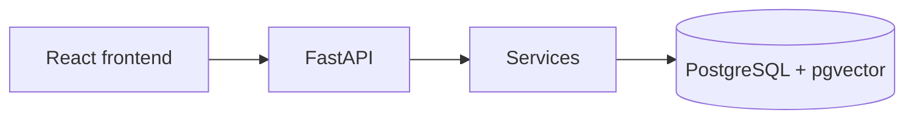
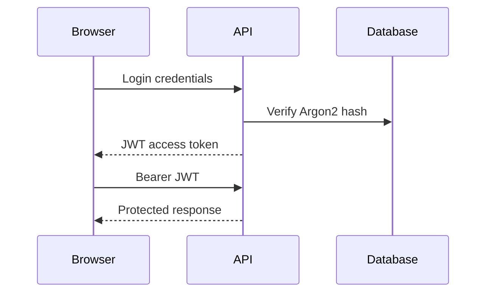
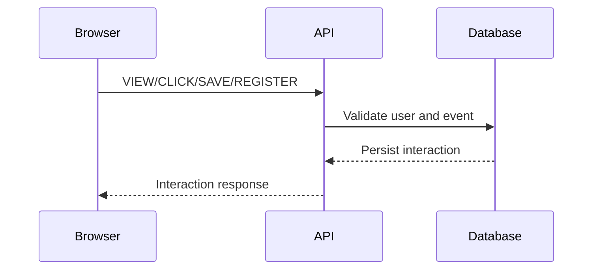
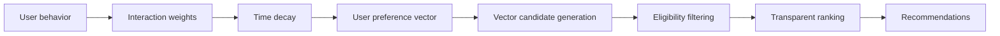

# EventSphere Backend

FastAPI + PostgreSQL + pgvector + SQLAlchemy + Alembic backend starter for the EventSphere personalized event discovery platform.

## 1. Project overview

EventSphere is a personalized event discovery platform. The backend provides
authentication, publisher event management, explicit interests, behavioral
interaction tracking, embeddings, and explainable recommendations.

## 2. Architecture

```text
React/Vite frontend
        |
      REST/JSON + JWT
        |
FastAPI routers -> services -> async SQLAlchemy
        |                         |
     Pydantic                 PostgreSQL + pgvector
```

The recommendation path is `interactions -> weighted profile -> pgvector
candidates -> eligibility filters -> transparent ranking`. An LLM is not
called for clicks or recommendations.

### Architecture diagrams










## 3. Tech stack

- React, Vite, Tailwind CSS, React Router
- FastAPI, Pydantic Settings, PyJWT, pwdlib/Argon2
- SQLAlchemy async, asyncpg, PostgreSQL, Alembic
- pgvector and Sentence Transformers

## 4. Repository structure

- `backend/app/api`: HTTP routers
- `backend/app/services`: embeddings, semantic text, recommendations
- `backend/app/models`: SQLAlchemy models
- `backend/app/schemas`: request/response contracts
- `backend/alembic`: database migrations
- `frontend/src`: React application and API client
- `backend/tests`: backend unit and integration tests

## 5. Local setup

```bash
docker compose up -d db
```

## 6. Environment variables

Windows PowerShell:

```powershell
py -3.11 -m venv .venv
.\.venv\Scripts\Activate.ps1
```

macOS/Linux:

```bash
python3.11 -m venv .venv
source .venv/bin/activate
```

Backend requires `DATABASE_URL` and a JWT secret with at least 32 characters.
`CORS_ORIGINS` is an explicit comma-separated allowlist; wildcard origins are
rejected. Copy [`backend/.env.example`](./.env.example) for local defaults and
never commit `.env`.

Frontend uses `VITE_API_URL`, documented in `frontend/.env.example`.

## 7. Docker setup

From the repository root:

```powershell
copy .env.example .env
docker compose up --build
```

Production secrets are supplied through the environment and are not baked into
images. The backend container runs migrations before Uvicorn; the frontend is
served by Nginx with SPA fallback.

## 8. Database setup

```bash
python -m pip install --upgrade pip
pip install -r requirements.txt
```

## 9. Alembic migrations

```bash
alembic revision --autogenerate -m "initial schema"
alembic upgrade head
```

The initial migration should include the `vector` extension and embedding column. If your generated migration does not include the extension, add `op.execute("CREATE EXTENSION IF NOT EXISTS vector")` before creating vector columns.

Migration head is `0005_performance_indexes`. The migration adds:

- `(status, start_time)` for public schedule filtering
- category filtering index
- pg_trgm semantic text search index
- HNSW cosine index on `events.embedding`
- interaction lookup indexes

The HNSW index is appropriate because recommendation candidate generation uses
cosine distance and pgvector supports HNSW approximate nearest-neighbor search.
It is intentionally created once in migration code, not per request.

## 10. Running backend

```bash
uvicorn app.main:app --reload
```

Open:
- http://127.0.0.1:8000/health
- http://127.0.0.1:8000/docs

## 11. Running frontend

```powershell
cd frontend
npm ci
npm run dev
```

## 12. API documentation

Open `/docs` for the generated OpenAPI documentation. Health endpoints are
`/health` and `/health/db`.

## 13. Authentication architecture

Passwords are hashed with Argon2. Login and registration return short-lived JWT
access tokens. Protected dependencies validate signature, algorithm, expiration,
and subject before loading the user. The frontend stores the token locally,
adds it only through the centralized client, and clears it on a 401 response.

## 14. Recommendation architecture

User behavior is weighted (`REGISTER > SAVE > LIKE > CLICK > VIEW`) and decayed
with `exp(-lambda * age_days)`. Event embeddings form a normalized user
preference vector. pgvector generates candidates, then category/interest,
behavior, popularity, recency, future-date, status, and registration filters
are applied before weighted ranking.

## 15. Interaction tracking

`POST /api/interactions` accepts `VIEW`, `CLICK`, `SEARCH`, `LIKE`, `SAVE`, and
`REGISTER`. Repeated short-window view/click/search records are rejected.
Interaction history is paginated.

## 16. Testing

```powershell
cd backend
python -m pytest -q
python -m ruff check app tests

cd ..\frontend
npm test
npm run lint
npm run build
```

The backend tests cover authentication, authorization, event lifecycle,
interactions, recommendations, deterministic embeddings, and hardening
endpoints. The frontend test suite covers token storage; browser flow checks
should be run against both services.

## 17. Deployment

Build and run the root Docker Compose stack with a deployment-specific `.env`.
Use a managed PostgreSQL/pgvector service, terminate TLS at a reverse proxy,
restrict `CORS_ORIGINS` to the frontend origin, and provide a high-entropy
`JWT_SECRET_KEY` through a secret manager.

## 18. Known limitations

- JWTs are bearer tokens stored in browser local storage; an HttpOnly refresh
  token strategy is a future hardening option.
- Embedding generation is currently an application service and should be moved
  to a background worker for high-volume publishing.
- Recommendation profile caching is process-local and expires after 60 seconds.
- Saved and registered frontend collections are currently local UI state; a
  future registration model should provide server-backed collections.

## 19. Future improvements

- Refresh-token rotation and token revocation
- Background embedding jobs and monitoring
- Redis or shared cache when multiple API workers need shared recommendation cache
- Server-side registrations/saves and transactional capacity management
- Full browser E2E tests in CI

## Current scope

Implemented:
- User registration and login at `/api/auth/register` and `/api/auth/login`
- Argon2 password hashing and JWT bearer access tokens
- Authenticated user endpoint at `/api/auth/me`
- Customer and publisher role dependencies
- Profile retrieval and updates at `/api/users/me`
- Explicit interest relationships with add/list/remove endpoints at
  `/api/users/me/interests`
- Publisher event creation
- Publisher event update, publish, cancel, delete, and own-event listing
- Public published-event listing and detail discovery with keyword, category,
  location, date, pagination, and sorting filters
- Deterministic event semantic text generation and reusable lazy-loaded embeddings
- Behavioral interaction tracking at `/api/interactions`
- Configurable, explainable recommendations at `/api/recommendations`
- SQLAlchemy async database access
- Alembic migrations
- pgvector column
- Sentence-transformer embedding service

The current migration head is `0004_interactions`. Apply all migrations with:

```bash
alembic upgrade head
```

Recommendations use explicit interests, weighted behavioral history, time decay,
semantic embeddings, vector candidate generation, popularity, and recency. The
debug endpoint is development-only.

Interaction types are `VIEW`, `CLICK`, `SEARCH`, `LIKE`, `SAVE`, and `REGISTER`.
Short-window duplicate `VIEW`, `CLICK`, and `SEARCH` events are rejected.

Recommendation pipeline:

```text
event -> semantic text -> 384d embedding
     -> pgvector candidate generation
     -> eligibility filtering
     -> interest/behavior/recency/popularity features
     -> transparent weighted ranking
     -> recommendations
```

## Frontend integration

From `frontend`, configure:

```text
VITE_API_URL=http://127.0.0.1:8000/api
```

The React app stores the access token in local storage under
`eventsphere_access_token`, attaches it through the centralized Axios client,
and clears it after a `401 Unauthorized` response. Start both applications:

```powershell
# backend
uvicorn app.main:app --reload

# frontend
npm run dev
```

The frontend communicates with the backend through `frontend/src/api.js`.
